# 🏍️ RoadGuard: Helmet & Number-Plate Violation Detector

**AI that spots motorcyclists without helmets and triple riding in traffic photos, videos or a live phone camera, reads their Pakistani number plates, and turns each violation into a reviewed PDF e-challan. It runs fully offline on a normal laptop CPU.**

      

> In Pakistan, motorcycles are most of the traffic and riding without a helmet is the most common
> violation. Islamabad Traffic Police alone issued 56,000+ helmet tickets in 2024, all by hand.
> RoadGuard shows how a single camera, or an officer's phone, could find these violations
> automatically, while a human still makes the final decision.

## 📸 Screenshots

| Review an AI detection | Dashboard |
|---|---|
| 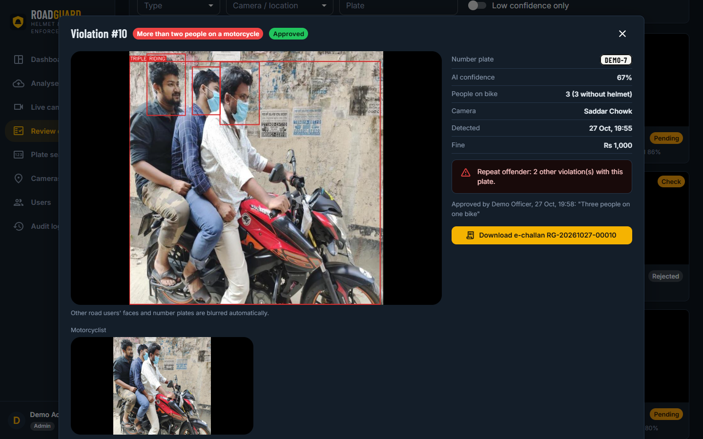 | 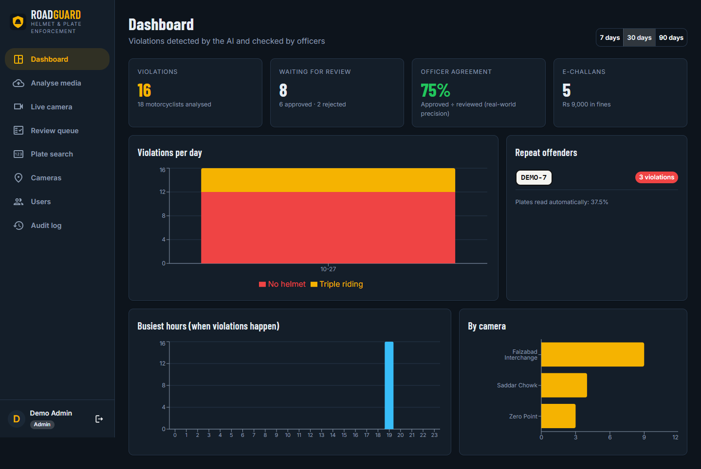 |
| **Review queue** (every detection waits for an officer) | **PDF e-challan** with a QR verification code |
| 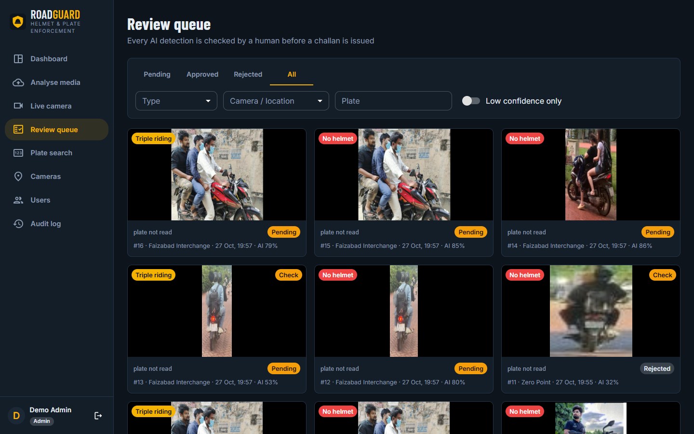 | 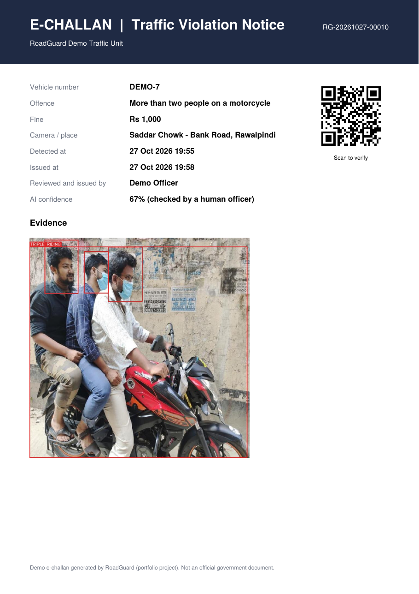 |
| **Repeat offender search** | **Analyse photos and videos** |
| 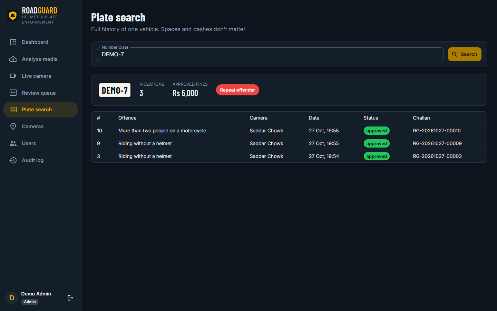 | 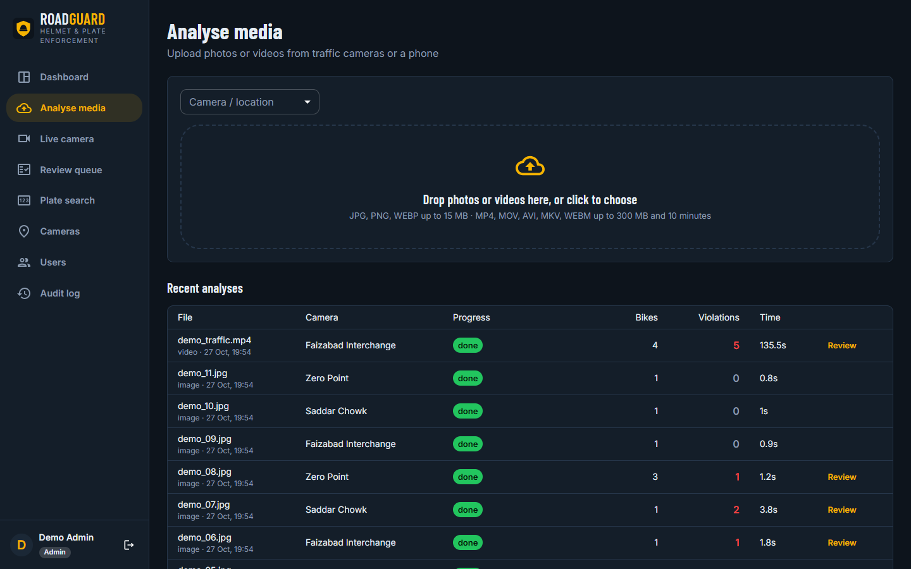 |
| **False alarm rejected by an officer** (bystanders blurred) | **Audit log** |
| 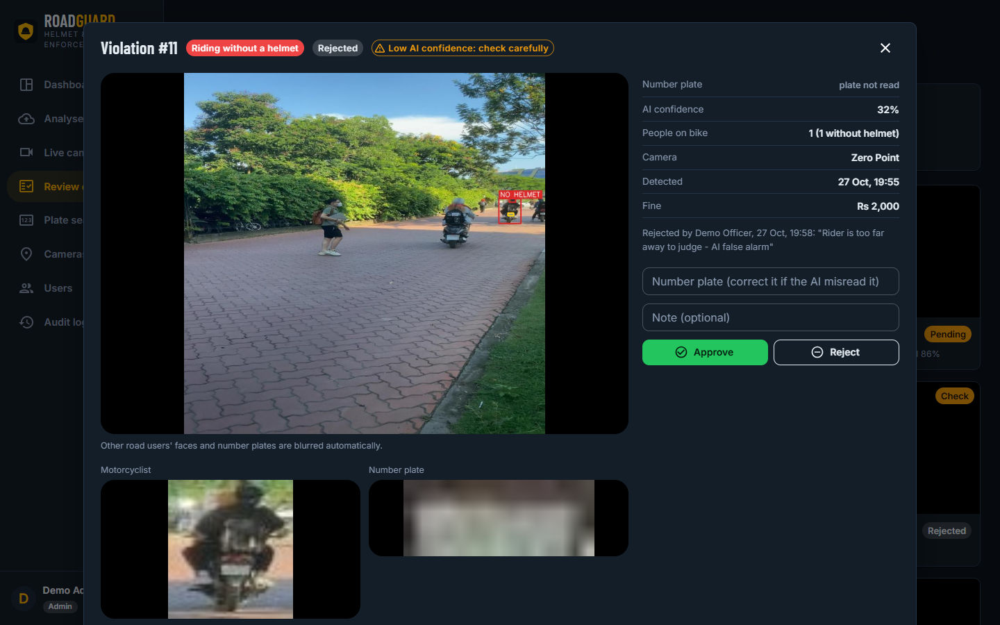 | 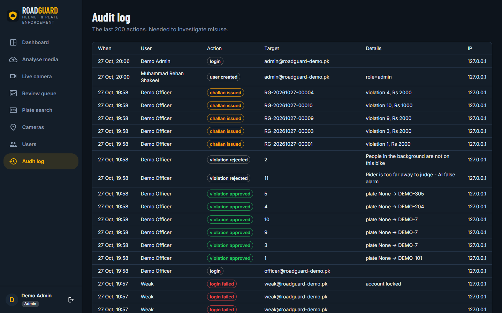 |

<p align="center">
  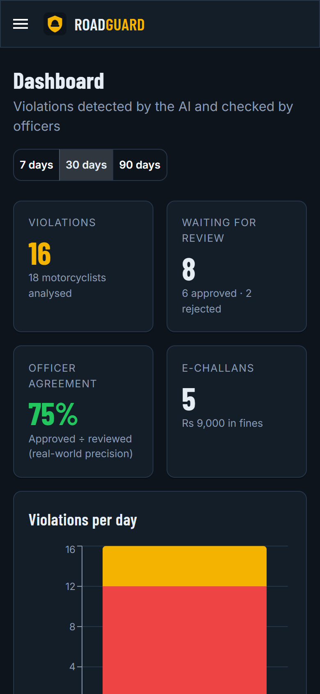
  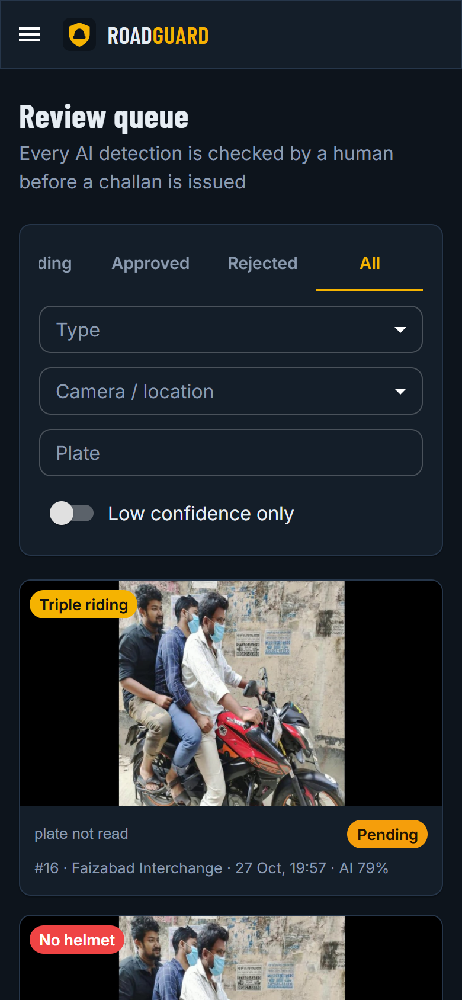
  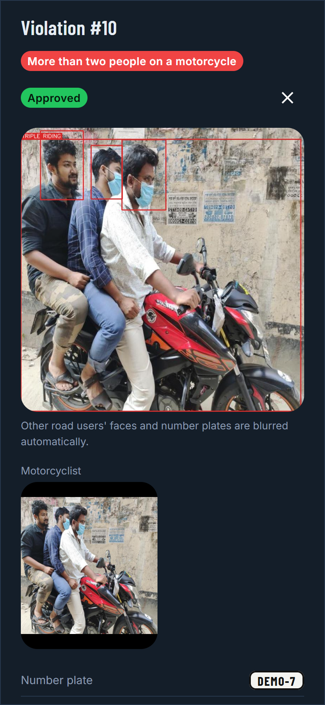
  <br><em>Same code as an Android app (Capacitor)</em>
</p>

Number plates in the screenshots (`DEMO-7` ...) were typed by the demo officer; demo photos are from the FPT test set (CC BY 4.0).


## ✨ Features

| | |
|---|---|
| 🪖 **No-helmet detection** | rider *and* pillion passenger, each head checked separately |
| 👨‍👩‍👦 **Triple riding** | 3+ people on one motorcycle |
| 🔢 **Pakistani plate reading** | offline OCR + a clean-up that understands Punjab / ICT / Sindh plates, 2-line bike plates and registration years |
| 🎞️ **Video tracking** | each bike is counted once; must break the rule in ≥ 2 frames; plate voting across frames; scene-cut detection for edited videos |
| 📱 **Live camera** | turns a phone (Android app) or webcam into a traffic camera, ~1 frame per second on a CPU |
| 🕵️ **Privacy by default** | bystanders' faces and plates are blurred; viewers see `LEA-**34` |
| 👮 **Human in the loop** | officer approves, rejects or corrects every detection before a fine |
| 🧾 **PDF e-challan** | evidence photos, fine, and a QR code anyone can scan to verify it is genuine |
| 🔁 **Repeat offenders** | full history of any plate; dashboard top list |
| 📊 **Dashboard** | violations per day, busiest hours, per camera, officer-agreement rate |
| 🔐 **Roles & audit log** | admin / officer / viewer; every login, approval and challan is logged |

## 📏 Results

| What | Result |
|---|---|
| Detector (YOLO11n), 328 unseen test images | **94.3% mAP50**, no-helmet: **94.3% precision / 88.7% recall** |
| Full pipeline on 12 demo photos | all **8/8** no-helmet riders caught (after adding a backup bike detector) |
| Different dataset (Kaggle, never trained on) | 8.7% mAP50: it boxes the whole rider, we box the head ([why](evaluation/RESULTS.md)) |
| Plate reading, 400 held-out synthetic plates | **87.5% exact** (raw OCR: 31.2%), **96.7% precision** on accepted plates |
| Speed, 2-vCPU cloud VM, no GPU | **~70-90 ms per frame**, about real time for video at 5 analysed fps |
| Automated tests | **85** (rules, tracking, plates, API security, jobs, live camera), CI on every push |

Full tables, per class and per difficulty: **[evaluation/RESULTS.md](evaluation/RESULTS.md)**

## 🧠 How it works

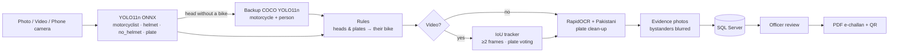

Plain-language explanation of every step: **[docs/HOW_IT_WORKS.md](docs/HOW_IT_WORKS.md)**

## 🛠 Tech stack

| Layer | Tools |
|---|---|
| AI | Ultralytics YOLO11n (trained on Colab T4) → ONNX Runtime (CPU) · RapidOCR (PP-OCR, ONNX) · OpenCV |
| Backend | FastAPI · Microsoft SQL Server (pyodbc) · bcrypt · JWT · ReportLab (PDF + QR) |
| Frontend | React 18 · Vite · Material UI · Redux Toolkit · Recharts |
| Mobile | Capacitor (Android app) · PWA |
| Quality | pytest (85 tests) · GitHub Actions · gitleaks · pip-audit |

## 🔐 Security

bcrypt passwords and account lockout · JWT with the user re-checked on every request · role-based
access on every route · no public sign-up · magic-byte upload validation and size/length limits ·
random file names · path-traversal guard · parameterised SQL only · rate limits (login, live camera,
global) · private evidence files · unguessable QR verify codes · audit log · security headers ·
secrets only in `.env` · gitleaks in CI. Details: [docs/HOW_IT_WORKS.md#8-security](docs/HOW_IT_WORKS.md#8-security)

## 🚀 Run it on Windows

Needs: Python 3.11, Node 20, SQL Server (Express is fine) + ODBC Driver 17.

1. The trained models are already in `backend/models/`. (To retrain: [`training/train_roadguard_colab.ipynb`](training/), free Colab GPU, about 1 h.)
2. Double-click **`setup_project.bat`**. It installs everything, creates the `RoadGuard` database and
   asks for your admin account.
3. Double-click **`start_project.bat`** → http://localhost:5174

| Script | Does |
|---|---|
| `run_tests.bat` | all 85 tests |
| `run_evaluation.bat` | plate accuracy + speed on your laptop |

**Android app:** in `frontend/.env` set `VITE_API_URL=http://<your-PC-Wi-Fi-IP>:5001`, set
`API_HOST=0.0.0.0` in `backend/.env`, then `npm run android:sync` and `npm run android:open` (Android Studio).

## 📂 Project structure

```
backend/
  app/services/   detector · rules · tracker · plates · evidence · analyzer · live · challan · job_queue
  app/routes/     auth · cameras · jobs · violations & challans · stats · live
  scripts/        schema.sql · init_db.py · setup_env.py
  models/         roadguard_yolo11n.onnx (trained) · yolo11n_coco.onnx (backup)
  tests/          85 tests (no SQL Server or model needed)
frontend/         React app + Android (Capacitor)
training/         Colab notebook (train → test → cross-dataset test → ONNX)
evaluation/       plate OCR eval, speed benchmark, results
docs/             HOW_IT_WORKS · WHERE_TO_CHANGE · INTERVIEW_NOTES
```

## ⚠️ Limitations

* The training images come from South/South-East Asian traffic, similar to Pakistan's but not
  identical, and the cross-dataset test shows that labelling style matters. Fine-tuning on a few
  hundred local Rawalpindi/Islamabad images is the next step.
* Plate accuracy is measured on synthetic plates; real, dirty plates will score lower. That is why an
  officer confirms every plate.
* This is a portfolio project. The e-challan says so and is not an official document.

## 📚 Datasets & credits
See [DATASETS.md](DATASETS.md). Training data: *Helmet Detection and License Plate Recognition* by FPT University (Roboflow Universe, CC BY 4.0).

## 👤 Author
**Muhammad Rehan Shakeel**, [GitHub](https://github.com/MuhammadRehanShakeel)

MIT License
