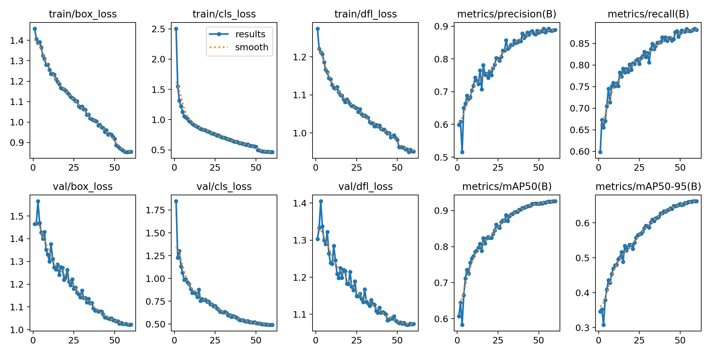

# RoadGuard: measured results

Everything here can be reproduced with the scripts in this folder (see `evaluation/README.md`).

## 1. Detector (YOLO11n, 640 px)

Trained with `training/train_roadguard_colab.ipynb` on a free Colab T4 (FPT University dataset v6,
Roboflow Universe, CC BY 4.0): 4,922 train / 1,312 validation / 328 test images, 22,300 labelled boxes.
Full numbers: [`results/training/training_report.json`](results/training/training_report.json).

**Test split (328 images the model never saw):**

| Class | Precision | Recall | mAP50 | mAP50-95 |
|---|---|---|---|---|
| motorcyclist | 93.4% | 96.6% | 98.9% | 90.6% |
| helmet | 86.3% | 83.3% | 90.0% | 57.2% |
| **no_helmet** | **94.3%** | **88.7%** | **94.4%** | 58.1% |
| plate | 92.7% | 89.0% | 93.7% | 64.3% |
| **All** | **91.7%** | **89.4%** | **94.3%** | **67.6%** |

**Cross-dataset test (Kaggle HelmetViolations, 933 images, never trained on): mAP50 8.7%.**
This low score is mostly a *labelling* difference, not the model failing. The confusion matrix
([`cross_confusion_matrix.png`](results/training/cross_confusion_matrix.png)) shows Kaggle's
`WithHelmet` boxes being matched by our `motorcyclist` boxes: that dataset draws one box around the
**whole rider**, while ours draws it around the **head**, so box overlap scoring cannot match them.
Lesson: before using RoadGuard at a new camera, label a few hundred local frames in the same style
and fine-tune again. That is listed as the next step.

**A gap found by testing the full pipeline.** The FPT dataset is a merge of several sources, and some
of them label heads but not the motorcyclist. In 7 of 12 demo photos the model found the bare head
but no motorcyclist box, so the rules could not link the head to a bike and no violation was raised.
Fix: a **backup detector** (the standard COCO-pretrained YOLO11n). It runs only when a head has no
bike around it, and builds the rider box from its `motorcycle` + `person` boxes.

| 12 demo photos (FPT test split) | Before the fix | With the backup detector |
|---|---|---|
| 8 photos with a rider without a helmet: violation found | 1 of 8 | **8 of 8** |
| 4 photos where everyone wears a helmet: false violation | 0 of 4 | 1 of 4 (a tiny far-away rider at 32% confidence, flagged "check carefully") |

This is a 12-image sanity check, not a benchmark, but it shows why end-to-end tests matter on top of mAP.

**Video check.** A 20-second test video made from 8 of the demo photos (each shown for 2.5 s with a slow
zoom, hard cuts in between):

| | Before scene-cut detection | After |
|---|---|---|
| Bikes counted | 4 (bikes from different scenes were joined into one track) | **8** (one per scene) |
| No-helmet violations | 3 | **8 of 8** |

## 2. Number-plate reading (OCR + clean-up)

400 **held-out** synthetic Pakistani plates (`data/synthetic_plates_test`, seed 7). The clean-up rules and
the 0.75 confidence threshold were tuned only on a separate dev set (`data/synthetic_plates_dev`, seed 42).

| Group | Plates | Raw OCR exact | **With clean-up exact** | Raw CER | With clean-up CER | Accepted automatically | **Precision of accepted** |
|---|---|---|---|---|---|---|---|
| **All** | 400 | 31.2% | **87.5%** | 54.3% | 8.8% | 90.5% | **96.7%** |
| Close & clear | 100 | 1.0% | 98.0% | 87.3% | 0.3% | 100% | 98.0% |
| Medium distance | 100 | 0.0% | 94.0% | 88.7% | 4.6% | 96.0% | 97.9% |
| Far, dark, noisy | 100 | 74.0% | 94.0% | 10.2% | 3.6% | 96.0% | 97.9% |
| Very far, low quality | 100 | 50.0% | 64.0% | 31.1% | 26.8% | 70.0% | 91.4% |
| Punjab car | 80 | 43.8% | 95.0% | 46.1% | 1.6% | 96.2% | 98.7% |
| Punjab motorcycle (2 lines) | 80 | 28.7% | 78.8% | 58.6% | 15.2% | 83.8% | 94.0% |
| Punjab with year | 80 | 0.0% | 85.0% | 82.0% | 10.9% | 88.8% | 95.8% |
| Islamabad (ICT) | 80 | 46.2% | 96.2% | 32.5% | 1.7% | 98.8% | 97.5% |
| Sindh | 80 | 37.5% | 82.5% | 52.4% | 14.5% | 85.0% | 97.1% |

**How to read this**
* *Raw OCR* is what RapidOCR returns. It includes printed words like "PUNJAB" and the small year, so
  for close, clear plates it is almost never the registration number itself. That is why the clean-up step exists.
* *Precision of accepted* is the number that matters for a challan: when RoadGuard says "I read this plate",
  it is right 96.7% of the time. The rest are marked unreadable and the officer types them.
* Two-line motorcycle plates and very distant plates are the hardest. Plate voting across video frames
  helps here (the best of up to 8 readings is used).
* **Limitation:** synthetic plates are cleaner than real ones (no mud, bends or custom fonts), so expect
  lower numbers on real roads. The officer review step is the safety net.

Examples fixed by the clean-up:

| Truth | Raw OCR | After clean-up |
|---|---|---|
| LEC-9029 | `PUNJAB LEC 21 9 9029` | LEC-9029 |
| VB-591 | `ICT VB5 591` | VB-591 |
| BNG-430 | `SINDH BNG-430` | BNG-430 |

## 3. Speed (CPU only, ONNX Runtime)

| Machine | Detector per frame | Plate OCR | Frames per second | Video speed (at 5 analysed fps) |
|---|---|---|---|---|
| Cloud VM, 2 vCPU (shared) | 68-87 ms | 450-550 ms | 4-5 | ~1× real time |
| Colab CPU (from the notebook) | 91 ms | | | |
| Your laptop | _run `scripts\windows\run_evaluation.bat`_ | | | |

OCR only runs for offending bikes (at most 8 readings per bike), so it does not slow down every frame.

## 4. Automated tests

85 tests (`backend/tests`), run on every push by GitHub Actions:
rules (15), tracking (7), plates (26), analyser and decoder (8), API security (25), jobs and live camera (4).
